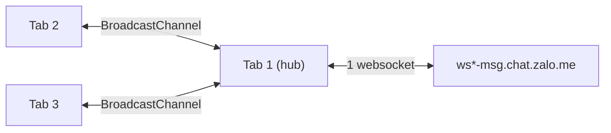

<!-- prettier-ignore -->
<div align="center">


# Z Tabs

[Website](https://nh4ttruong.github.io/z-tabs/) • [Install](#install) • [How it works](#how-it-works) • [Limits](#limits) • [Develop](#develop)

</div>

Browser extension for [Zalo Web](https://chat.zalo.me).
All Zalo tabs share one connection, so none of them gets kicked out with "Zalo is open in another tab".

## Install

 **Edge:** get it from [Edge Add-ons](https://microsoftedge.microsoft.com/addons/detail/jofjdigkccpakpapllagcafjgflbmikd), then click the Z Tabs icon and flip the switch.

 **Chrome and other Chromium browsers:**

1. Download `z-tabs-<version>.zip` from [Releases](https://github.com/nh4ttruong/z-tabs/releases/latest) and unzip it.
2. Open the browser's extensions page (`chrome://extensions`, ...), enable **Developer mode**, click **Load unpacked** and pick the unzipped folder.
3. Click the Z Tabs icon and flip the switch.

Turning on with a single Zalo tab opens a second one next to it, in the background.

| Popup | What it does |
|---|---|
| Switch | Turns multi-tab mode on or off for every Zalo tab |
| ↻ button | Reloads Zalo tabs when you flip the switch (on by default); when off, the footer offers **Reload N tabs** instead |
| Green badge | Number of Zalo tabs, shown from 3 tabs up, also on the toolbar icon |

## How it works

Zalo Web allows one tab in two places:

- **Client lock.** A new tab writes a UUID to `localStorage["sh_singleton_web_app"]`; older tabs get the `storage` event, close their socket and show the "open in another tab" screen.
- **Server limit.** One chat websocket per account; a second connection makes the server send cmd `3000` to the first one and drop it.

Z Tabs handles both:

- Every tab ignores the other tabs' singleton writes.
- The tab holding the Web Lock `ztabs:hub` is the hub and owns the only real websocket; the other tabs relay over `BroadcastChannel("ztabs:relay")`.



The hub replays the cached handshake to each new tab, sends each response to the tab that made the request and broadcasts everything else.
When several tabs wait on the same cmd, it matches `reqId`/`eventId`, decrypting the response only to read that id.
If no handshake arrives within 10 s, every tab falls back to plain single-tab Zalo Web.
When the hub tab closes or freezes, another tab takes over within a few seconds.

The core script is registered only while Z Tabs is on, so turning it off and reloading gives plain Zalo Web.
Nothing leaves the browser: Z Tabs keeps no logs and sends nothing.

## Limits

- Not an official Zalo feature; a Zalo Web update may break it, and the 10 s fallback keeps the session usable when it does.
- Zalo PC or Zalo Web in another browser still takes the single connection and disconnects every tab here.
- Tabs share Zalo's IndexedDB, so a conversation list may rarely need a reload.

## Develop

Needs Node.js 20+ and `zip`.

```bash
# Install dependencies and the Chromium used by the tests
npm install
npx playwright install chromium

# End-to-end test in headless Chromium with chat.zalo.me mocked (about 35 s)
npm test

# Regenerate icons/ after editing assets/logo*.svg
npm run icons

# Build dist/z-tabs-<version>.zip
npm run zip
```

To debug a real Zalo tab, run `sessionStorage.setItem("ztabs:debug", "1")` in its console and reload for `[ztabs]` logs; `__ztabs.status()` shows the tab's role and sockets.
[`tools/probe/`](tools/probe) is a separate dev-only extension that logs Zalo Web's tab-lock and websocket behaviour, for when Zalo changes its protocol.
